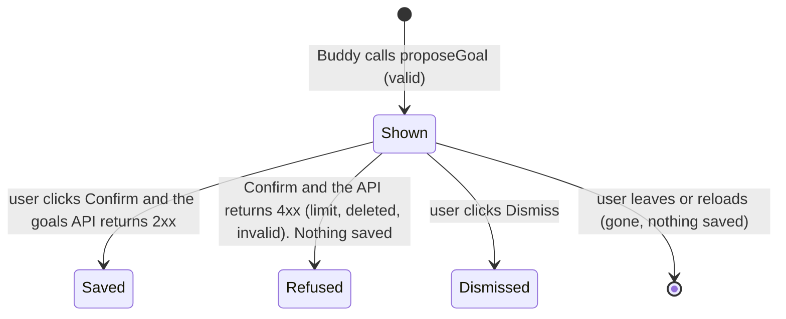

# Data Model: Personal Goals (F013)

## 1. PersonalGoal (stored)

Table `personal_goal`. Entity `model/PersonalGoal`. It has no JPA relation to `User` (research R1).

| Field | Column | Type | Rules |
|---|---|---|---|
| id | `id` | UUID PK | Generated (`GenerationType.UUID`) |
| userId | `user_id` | UUID, NOT NULL | FK `users(id) ON DELETE CASCADE`. Every lookup is by (user, id) |
| goal | `goal_text` | VARCHAR(150), NOT NULL | Trimmed, 1–150 characters |
| howToHelp | `how_to_help` | VARCHAR(500), NULL | Trimmed, ≤ 500 characters. Blank is stored as null |
| createdAt | `created_at` | TIMESTAMPTZ, NOT NULL | From the injected `Clock` |
| updatedAt | `updated_at` | TIMESTAMPTZ, NOT NULL | From the `Clock`. Set on create and on each update |

- **Limit**: at most 3 rows per user. This is enforced in `create` under a user-row lock (research R2). A 4th → 409.
- **Order**: `created_at`, then `id`.
- **Index**: `(user_id, created_at)`.
- **Deletion**: a hard delete. Deleting the user removes their goals (cascade).

Prod DDL is `ms-personal-routine-manager/db/F013-personal-goals.sql`. It is idempotent and applied before the F013 image starts (Principle III). Locally, `ddl-auto` builds the table.

```sql
CREATE TABLE IF NOT EXISTS personal_goal (
    id          UUID                     PRIMARY KEY,
    user_id     UUID                     NOT NULL REFERENCES users(id) ON DELETE CASCADE,
    goal_text   VARCHAR(150)             NOT NULL,
    how_to_help VARCHAR(500),
    created_at  TIMESTAMP WITH TIME ZONE NOT NULL,
    updated_at  TIMESTAMP WITH TIME ZONE NOT NULL
);
CREATE INDEX IF NOT EXISTS idx_personal_goal_user ON personal_goal (user_id, created_at);
```

## 2. GoalRules (pure rule, `funcs/GoalRules`)

| Constant | Value |
|---|---|
| `MAX_GOALS` | 3 |
| `GOAL_MAX` | 150 |
| `HELP_MAX` | 500 |

`normalize(goal, howToHelp)` returns `(goal, howToHelp)`, trimmed, with a blank help text as null. Otherwise it throws `IllegalArgumentException` with one of these messages:

- `Goal is required.` (null, empty or whitespace only)
- `Goal must be 150 characters or fewer.`
- `How Buddy should help must be 500 characters or fewer.`

Lengths are counted after trimming, in Java `String.length()`. The frontend mirrors this rule in `personal-target/utils/goalRules.ts`.

## 3. GoalProposal (not stored)

The proposal is built by `GoalProposalTool` during one Buddy reply and returned once in `ChatResponse.goalProposal` (research R5).

| Field | Type | Notes |
|---|---|---|
| action | `ADD` \| `UPDATE` | |
| goalId | UUID \| null | Required for `UPDATE`. It must be one of the user's goals when proposed |
| goal | string | Normalised by `GoalRules` |
| howToHelp | string \| null | For `UPDATE`, a blank value keeps the current one |
| current | `{ goal, howToHelp }` \| null | For `UPDATE` only. Read from the database |



## 4. BuddyReply (internal)

`service/BuddyReply(String text, GoalProposalView goalProposal)` is the return type of `AiChatService.defaultRoutineChat`, `AiChatService.dailyRoutineChat` and `ReflectionAiService.chat`. Only `text` goes into chat history.
